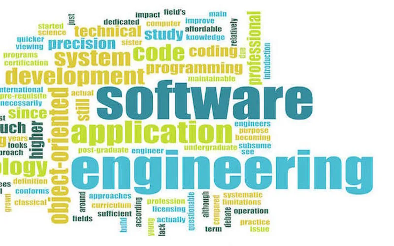
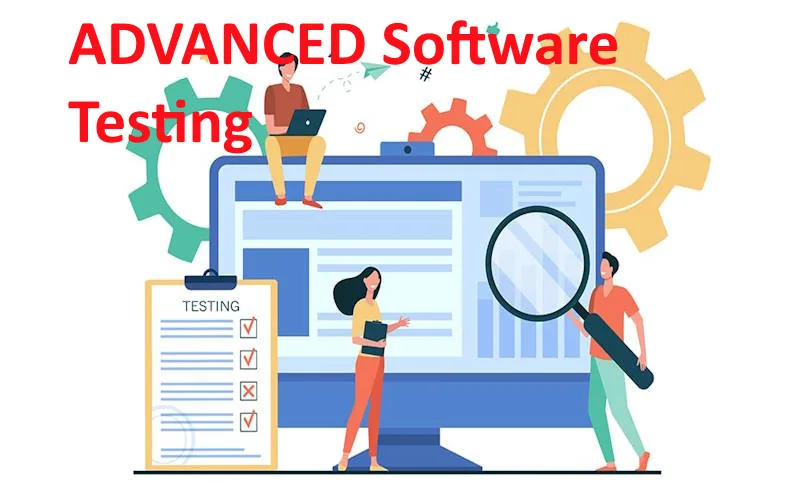

دانشکده مهندسی کامپیوتر — دانشگاه صنعتی امیرکبیر (پلی‌تکنیک تهران)

<h1 class="hero__title">آزمایشگاه مهندسی نرم‌افزار هوشمند</h1>

خودکارسازی وظایف مهندسی نرم‌افزار — از طراحی و توسعه تا محصول نهایی — با بهره‌گیری از فنون هوش مصنوعی، کامپایلرها و زبان‌های خاص‌منظوره؛ برای کاهش هزینه‌ها و افزایش بازدهی تیم‌های نرم‌افزاری.

[فعالیت‌های پژوهشی](research/index.md){ .md-button .md-button--primary }
[خدمات و محصولات](industry/index.md){ .md-button }
[ارتباط با ما](contact.md){ .md-button }

<ul class="hero__facts">
<li><strong>۳</strong> گروه پژوهشی فعال</li>
<li><strong>۹</strong> درس، دوره و کارگاه</li>
<li><strong>پژوهش · صنعت · آموزش</strong></li>
</ul>

{ .no-lightbox loading=eager }

<ul class="marquee__track">
<li>آزمون خودکار نرم‌افزار</li>
<li>مکان‌یابی خودکار خطا</li>
<li>بازآرایی خودکار کد</li>
<li>مهندسی معکوس</li>
<li>تکامل نرم‌افزار</li>
<li>کامپایلرها و ترنسپایلرها</li>
<li>زبان‌های خاص‌منظوره</li>
<li>امنیت نرم‌افزار</li>
<li>مهندسی نیازمندی‌ها</li>
<li>سنجش کیفیت نرم‌افزار</li>
</ul>
<ul class="marquee__track" aria-hidden="true">
<li>آزمون خودکار نرم‌افزار</li>
<li>مکان‌یابی خودکار خطا</li>
<li>بازآرایی خودکار کد</li>
<li>مهندسی معکوس</li>
<li>تکامل نرم‌افزار</li>
<li>کامپایلرها و ترنسپایلرها</li>
<li>زبان‌های خاص‌منظوره</li>
<li>امنیت نرم‌افزار</li>
<li>مهندسی نیازمندی‌ها</li>
<li>سنجش کیفیت نرم‌افزار</li>
</ul>

درباره آزمایشگاه

<h2 class="section-head__title">سه محور، یک هدف: نرم‌افزار باکیفیت‌تر</h2>

آزمایشگاه تحقیقاتی مهندسی نرم‌افزار هوشمند <a href="https://aut.ac.ir/" target="_blank" rel="noopener">دانشگاه صنعتی امیرکبیر</a> در زمینه سنجش و بهبود کیفیت فرایندها و مصنوعات نرم‌افزاری، آزمون نرم‌افزار، مهندسی معکوس و تکامل نرم‌افزار فعالیت می‌کند.

[:fontawesome-solid-flask:
۰۱
پژوهش
سه گروه پژوهشی فعال در حوزه‌های آزمون و اشکال‌زدایی، طراحی و معماری، و متدولوژی نرم‌افزار.
فعالیت‌های پژوهشی :octicons-arrow-left-24:](research/index.md){ .pillar }

[:fontawesome-solid-industry:
۰۲
صنعت
خدمات مهندسی مشاوره‌ای و محصولات نرم‌افزاری برای صنایع و سازمان‌ها.
خدمات و محصولات :octicons-arrow-left-24:](industry/index.md){ .pillar }

[:fontawesome-solid-graduation-cap:
۰۳
آموزش
دروس دانشگاهی، آموزش‌های آزاد و کارگاه‌های تخصصی مهندسی نرم‌افزار.
دروس و دوره‌ها :octicons-arrow-left-24:](courses/index.md){ .pillar }

پژوهش

<h2 class="section-head__title">فعالیت‌های پژوهشی</h2>

فعالیت‌های پژوهشی آزمایشگاه بر آزمون و اشکال‌زدایی برنامه، تحلیل نرم‌افزار، سنجش کیفیت داخلی و خارجی، مهندسی معکوس و بازآرایی، و متدلوژی‌های نرم‌افزار متمرکز است.

<ol class="steps">
<li>گروه آزمون و اشکال‌زدایی نرم‌افزار</li>
<li>گروه طراحی و معماری نرم‌افزار</li>
<li>گروه متدولوژی نرم‌افزار و مهندسی نیازمندی‌ها</li>
</ol>

[همه فعالیت‌های پژوهشی](research/index.md){ .md-button }

[:fontawesome-solid-flask:
پژوهش و توسعه در مهندسی نرم‌افزار
روش‌ها و فناوری‌های نوین برای بهبود کیفیت، کارایی و قابلیت اطمینان سیستم‌های نرم‌افزاری.](research/index.md){ .tile }

[:fontawesome-solid-layer-group:
پژوهش‌های بین‌رشته‌ای
تلفیق مهندسی نرم‌افزار با مواد، عمران، محیط زیست، پزشکی و کشاورزی.](research/interdisciplinary_research.md){ .tile }

[:material-application-cog:
پژوهش‌های کاربردی
تشخیص هوشمند پول‌شویی، جرائم مالی و هوشمندسازی صنعت بیمه.](research/applied_research.md){ .tile }

[:fontawesome-solid-lightbulb:
ایده‌ها و موضوعات
پیشنهادهای پژوهشی برای پروژه‌های کارشناسی، پایان‌نامه‌ها و رساله‌ها.](research/research_rfps.md){ .tile }

صنعت

<h2 class="section-head__title">از پژوهش تا محصول</h2>

خدمات مهندسی مشاوره‌ای در آزمون خودکار نرم‌افزار، امنیت نرم‌افزار و ضدویروس‌های هوشمند، مهندسی معکوس و تحلیل هوشمند برنامه، بازآرایی خودکار و هوشمندسازی فرایندهای توسعه و استقرار نرم‌افزار.

[:simple-litiengine:

موتور بازآرایی خودکار
بازآرایی خودکار کد، بهینه‌سازی معماری نرم‌افزار و بهبود خوانایی و قابلیت نگهداری کد.

:octicons-arrow-up-left-24:](https://www.m-zakeri.ir/CodART/){ .product target=_blank rel=noopener }

[:fontawesome-solid-shield-virus:

ضدویروس هوشمند
تشخیص بدافزارهای پیچیده و حملات سایبری به‌صورت بلادرنگ با یادگیری ماشین.

:octicons-arrow-left-24:](industry/products.md){ .product }

[همه خدمات و محصولات](industry/index.md){ .md-button .md-button--primary } [موقعیت‌های شغلی](industry/positions.md){ .md-button }

آموزش

<h2 class="section-head__title">دروس فعال آزمایشگاه</h2>

دوره‌های تخصصی در آزمون و تضمین کیفیت، طراحی و توسعه امن نرم‌افزار، مهندسی کامپایلرها و ترنسپایلرها، و معماری و کدنویسی پاک.

[{ .no-lightbox loading=lazy }

کارشناسی
مهندسی کامپایلر
اصول طراحی و پیاده‌سازی کامپایلرها، تحلیل واژگانی و نحوی، و بهینه‌سازی کد.
](courses/compiler_engineering.md){ .course }

[{ .no-lightbox loading=lazy }

کارشناسی
آزمون نرم‌افزار
آزمون جعبه‌سیاه و جعبه‌سفید، خودکارسازی آزمون و تحلیل خطاها.
](courses/software_testing.md){ .course }

[{ .no-lightbox loading=lazy }

تحصیلات تکمیلی
مهندسی نرم‌افزار پیشرفته
معماری نرم‌افزار، متدولوژی‌های توسعه، مهندسی نیازمندی‌ها و تضمین کیفیت.
](courses/software_engineering_advanced.md){ .course }

[{ .no-lightbox loading=lazy }

تحصیلات تکمیلی
آزمون نرم‌افزار پیشرفته
مدل‌های پیشرفته آزمون، آزمون امنیتی، آزمون عملکردی و قابلیت اطمینان.
](courses/software_testing_advanced.md){ .course }

[همه دروس و دوره‌ها](courses/index.md){ .md-button }

<h2 class="cta__title">همکاری با آزمایشگاه</h2>

برای طرح پرسش، پیشنهاد همکاری پژوهشی یا صنعتی، یا درخواست خدمات با ما در ارتباط باشید.

[ارتباط با ما](contact.md){ .md-button .md-button--primary }
[پرسش‌های متداول](faq.md){ .md-button }

